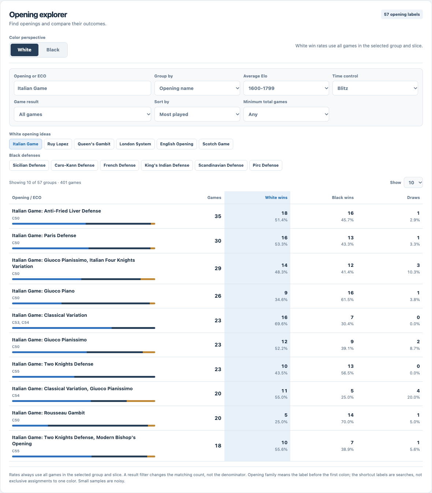

# Chess Data Lakehouse

A data engineering project that turns public Lichess PGN exports into Bronze, Silver, quarantine and Gold datasets. Version 0.3 adds opening analysis by ECO, rating and time control, plus rating-gap, termination and game-length metrics. It uses Python for a local pipeline and PySpark/Delta Lake for a managed-table implementation. The accompanying dashboard explores verified aggregate metrics without publishing player names, game IDs or raw PGN.

I enjoy chess, and I wanted to see if I could build a repeatable data pipeline using real game data. This project grew out of that curiosity.

**Dashboard:** [Live dashboard](https://tasachii.github.io/chess-data-lakehouse/) (previous 10,000-game release) · [Dashboard source](docs/index.html) · [100,000-game aggregate data](docs/assets/snapshot.json) · [Passing CI run for the previous release](https://github.com/Tasachii/chess-data-lakehouse/actions/runs/46021313046)




## Contents

- [Quick start](#quick-start)
- [Real data and dashboard](#real-data-and-dashboard)
- [Architecture](#architecture)
- [Tests](#tests)
- [Databricks](#databricks)
- [Source, license and limits](#source-license-and-limits)

## Quick start

**Requirements:** Python 3.11 or 3.12. Commands below use Python 3.12 and a Unix-style shell.

```bash
python3.12 -m venv .venv
.venv/bin/python -m pip install -e '.[dev]'
.venv/bin/chess-lakehouse run \
  --input tests/fixtures/sample.pgn \
  --output output/fixture-v3 \
  --source-url fixture://sample.pgn
```

The synthetic fixture contains three records (one duplicate and one malformed game). The first run produces two Bronze records, one valid Silver record and one quarantined record. Repeat the same command to confirm `inserted_bronze: 0`. The fixture is not real Lichess data.

## Real data and dashboard

The current local dashboard (v0.3) uses the first **100,000 games** from the October 2026 Lichess rated standard archive. The validated games have start times between 00:00:00 and 01:22:41 UTC on October 1, 2026. This is a static archive snapshot, not a live feed or random sample.

| Metric | Measured value |
| --- | ---: |
| Unique Bronze records | 100,000 |
| Valid Silver games | 99,875 |
| Quarantined | 125 |
| Opening labels / rating buckets / speeds | 2,018 / 15 / 4 |
| Opening / ECO / rating / speed combinations | 18,342 |
| Games with valid ECO / known mainline length | 99,633 / 99,633 |
| White wins / black wins / draws | 49,550 / 46,550 / 3,775 |

All 125 quarantined records have invalid time-control fields; 25 of them also have an invalid result. A second local pipeline run inserted zero records. The dashboard exporter independently compares every Gold group with Silver counts before exporting; it includes only aggregate labels, game counts, outcome counts and source metadata. For example, the literal Italian Game search matches 3,883 validated games (1,939 White wins), and Ruy Lopez matches 1,722 (838 White wins). These totals include matching variations.

### Reproduce the snapshot

```bash
SOURCE_URL=https://database.lichess.org/standard/lichess_db_standard_rated_2026-10.pgn.zst
.venv/bin/chess-lakehouse download \
  --url "$SOURCE_URL" --output data/dashboard_sample_100000.pgn --max-games 100000
.venv/bin/chess-lakehouse run \
  --input data/dashboard_sample_100000.pgn --output output/dashboard-100000-v3-final --source-url "$SOURCE_URL"
.venv/bin/python scripts/export_dashboard.py --lakehouse output/dashboard-100000-v3-final
```

Use a fresh output directory for v0.3 or a different sample. Older v0.2 outputs are not upgraded in place. The downloader saves a receipt next to the PGN with its bound, source checksum and retrieval time. The exporter verifies that a single source batch produced the lakehouse and that the group counts reconcile. Re-downloading may produce a new retrieval timestamp; the PGN checksum and group metrics identify the sample itself.

### Preview the dashboard locally

```bash
.venv/bin/python -m http.server 8765 --directory docs
```

Open [http://localhost:8765/](http://localhost:8765/). Search opening names, family names or ECO codes (for example `C50`). White opening ideas and Black defenses are shortcuts to real Lichess labels. Select an average-Elo bucket, speed and minimum games to compare a meaningful slice. The table explicitly shows White wins, Black wins and draws with counts and rates. Select a color perspective to emphasize its win rate, or a result filter to count only matching outcomes. Rates always divide by all games in the selected opening group and slice. Family means the label before the first colon; it is not an official taxonomy or an exclusive assignment to one color. The separate rating-gap, termination and length charts show the full sample.

The site uses plain HTML, CSS and JavaScript. It requires no build step, server API or account. The earlier 10,000-game release was published on GitHub Pages from `main:/docs` and passed independent live checks. This enriched 100,000-game update has been tested locally and is ready for publication; it has not yet been deployed.

## Architecture

```text
Lichess PGN.zst → bounded download and receipt → Bronze (raw, deduplicated)
                                                   │
                                                   ├── Quarantine (invalid)
                                                   ↓
                                                Silver (typed)
                                                   ↓
                   Dashboard JSON ← Gold (opening context, rating, speed,
                                            rating gap, termination, length)
```

| Layer | Grain | Storage / update |
| --- | --- | --- |
| Bronze | One record per unique game ID | JSONL or Delta; insert only |
| Silver | One validated game | JSONL or Delta; local rebuild, Delta insert only |
| Quarantine | One invalid unique game | JSONL or Delta; retained with errors |
| Gold | One row per opening, rating bucket or speed | CSV or Delta; full aggregate rebuild |
| Opening context | One row per opening, ECO, rating bucket and speed | Exact slice counts; stable cross-filtering |
| Additional Gold | One row per signed rating-gap bucket, termination or mainline-length bucket | Outcome counts; length also stores known-game and total-ply counts |
| Run history | One source file per successful invocation | JSON manifests or `ingestion_runs` Delta table; append only |

| Decision | Reason |
| --- | --- |
| Stable ID from the Lichess `Site` URL | Recognizes both `/game/<id>` and `/<id>`; a content hash is used for nonmatching URLs. Prevents replay double counts. |
| Split on each Event tag | Keeps incomplete records from contaminating valid ones. |
| Validate before aggregation | Required fields, integer Elo within 100–4000, UTC timestamp, result, time control and move-text presence. |
| Durable batch identity | Source URL and exact file SHA-256 identify a batch; each Bronze row refers to its first batch. |
| Aggregate-only export | Dashboard never needs the raw source or individual game records. |

A rating bucket is the integer mean of White and Black Elo, grouped by 200 points. Speed uses an estimated duration of `initial seconds + 40 × increment`: under 180 is bullet (including ultrabullet), under 600 blitz, under 1,800 rapid, otherwise classical. The outcome rate divides the relevant count by validated games in the group. Stored rates are rounded to four decimal places with half-even ties in Python and Spark; the dashboard recomputes rates directly from integer counts, not other rounded rates. A signed rating gap is White Elo minus Black Elo before the game. Valid ECO and recognized termination tags are preserved; unsupported or missing values are `Unknown`. Mainline length counts SAN-shaped half-moves after removing simple PGN comments, without testing move legality; result-only or unsupported move text is null and grouped as `Unknown`. Clock/eval annotations are audited for coverage but not used as performance measures.

More on the data contracts, replay behavior and cloud configuration: [Operations and validation notes](DEV_HANDOFF.md).

## Tests

```bash
.venv/bin/python -m pytest -ra
.venv/bin/ruff check .
.venv/bin/ruff format --check src tests scripts
```

The [Chess Lakehouse CI workflow](.github/workflows/ci.yml) runs on pushes, pull requests and manual dispatch using GitHub-hosted Ubuntu runners. It checks the base Python tests, including the aggregate export, Ruff lint and formatting, and JavaScript syntax. A separate job runs Spark/Delta fixture tests with Python 3.12 and Java 17; it needs no credentials, real archive download or Databricks workspace. Both hosted jobs passed for the previous release in [this CI run](https://github.com/Tasachii/chess-data-lakehouse/actions/runs/46021313046). Real-data Spark parity is tested locally, and browser interactions have passed independent live-site checks.

The default local suite tests ingestion, validation, deduplication, corrupted/truncated inputs, lineage and aggregate export. Spark tests are optional. To run the full suite, install a compatible JDK and the pinned Spark/Delta extra (PySpark 3.5.3, Delta 3.3.2):

```bash
.venv/bin/python -m pip install -e '.[dev,spark]'
.venv/bin/chess-lakehouse download \
  --url https://database.lichess.org/standard/lichess_db_standard_rated_2026-10.pgn.zst \
  --output data/real_sample_100.pgn --max-games 100
SPARK_LOCAL_IP=127.0.0.1 CHESS_TEST_DELTA=1 \
  CHESS_REAL_SAMPLE="$PWD/data/real_sample_100.pgn" \
  .venv/bin/python -m pytest -s -ra
```

Independent testing confirmed the local pipeline at commit `94f58a11304cc11c92e102f3894aabcbdcc80ce9`. The dashboard does not change pipeline behavior. The measured test and run evidence is in [Run evidence](docs/run-evidence.md). The optional locally executed Delta JAR route and browser test commands are in [Operations and validation notes](DEV_HANDOFF.md) and [Publication notes](PUBLICATION_HANDOFF.md).

## Databricks

The v0.2 [Databricks bundle](databricks.yml) passed official CLI validation and was deployed as a serverless Python job. Two runs completed successfully on the same bounded 10,000-game October sample. Direct SQL queries after the second run confirmed the following results across seven managed Delta tables:

| Cloud verification | Result |
| --- | ---: |
| Bronze rows / distinct game IDs | 10,000 / 10,000 |
| Silver rows / quarantine rows | 9,996 / 4 |
| Sum of games in each of the three Gold tables | 9,996 |
| Run history rows | 2 |
| Second-run inserts / duplicates | 0 / 10,000 |

The replay demonstrates idempotency: it keeps the same unique records and adds no duplicate games. These cloud results belong to the 10,000-game v0.2 sample; the enriched 100,000-game v0.3 dashboard was processed locally, and all Gold marts were compared with local Spark. The v0.3 cloud execution is not yet verified. Use a fresh schema and split the exact source into ten bounded 10,000-game files; the job reads the chunks with a glob and verifies each file's record bound. The dashboard is a static snapshot, and the job is a bounded batch rather than continuous ingestion. Local Spark and Delta tests also verified parity on a separate 100-game sample. See [cloud run instructions](DEV_HANDOFF.md#databricks-run-instructions) and the [verified chunk manifest](docs/assets/sample-chunks-manifest.json) for the planned v0.3 deployment.

## Source, license and limits

- **Data:** [Lichess Open Database](https://database.lichess.org/) · [CC0 1.0](https://creativecommons.org/publicdomain/zero/1.0/). The [October 2026 archive](https://database.lichess.org/standard/lichess_db_standard_rated_2026-10.pgn.zst) is a monthly export; only a bounded prefix was downloaded.
- **Code:** [MIT License](LICENSE).
- **Limits:** This is a bounded micro-batch pipeline, not a continuous stream or full-month analysis. The local pipeline and Spark read bounded files into memory; serial execution and stable input files are required. It does not validate chess move legality or provide cross-table atomic transactions. Unknown optional fields stay unknown; the average length excludes unknown lengths. Rates are descriptive, not causal estimates of player skill.
- **Privacy:** Raw PGN, local environments, receipts and generated lakehouse outputs are ignored by Git. The public dashboard contains only grouped statistics and source metadata.
