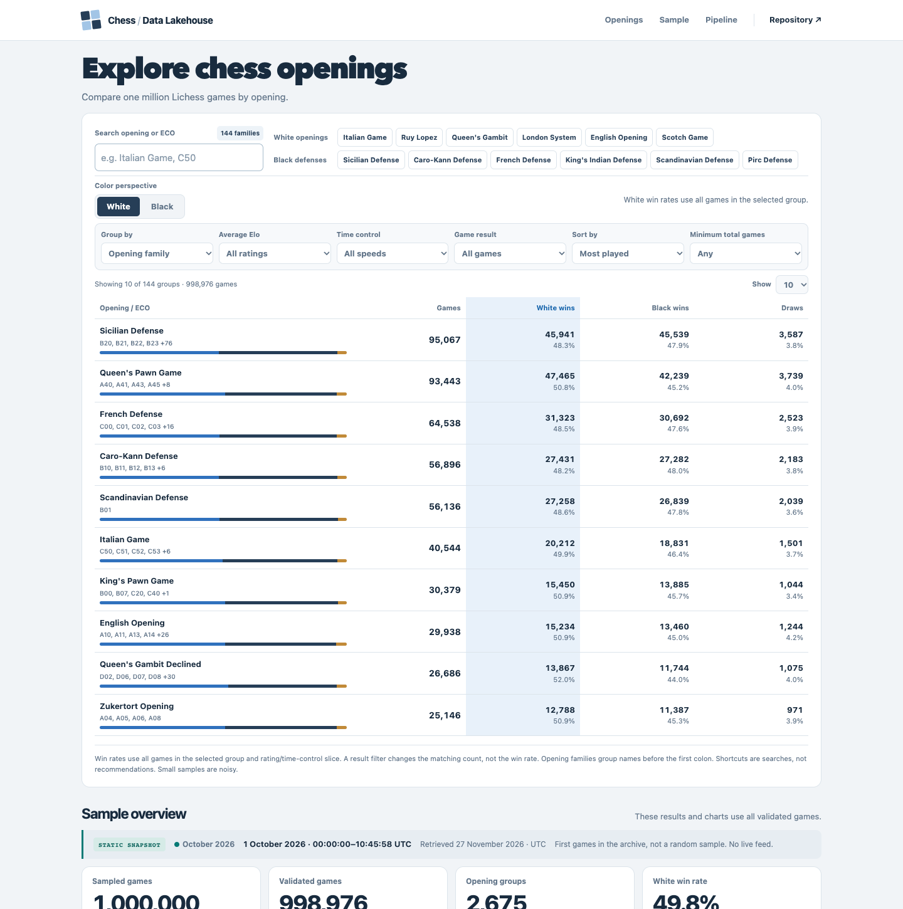

# Chess Data Lakehouse

I enjoy chess and wanted to see how different openings fare at different ratings. I built a data pipeline for one million rated games from Lichess so I could explore this question. Pick an opening in the dashboard to see how often White won, Black won, or the game ended in a draw.

**Try it now:** [Live dashboard](https://tasachii.github.io/chess-data-lakehouse/) · [Dashboard source](docs/index.html) · [Download aggregate data (JSON)](docs/assets/snapshot.json)

| Search and compare openings | Italian Game study by rating and time control |
| --- | --- |
|  |  |

## Contents

- [Explore the dashboard](#explore-the-dashboard)
- [The data](#the-data)
- [Quick start](#quick-start)
- [Architecture](#architecture)
- [Databricks](#databricks)
- [Tests](#tests)
- [Source, license and limits](#source-license-and-limits)

## Explore the dashboard

- Start with the opening search at the top. Use quick choices such as Italian Game, Ruy Lopez or Sicilian Defense, or type an opening name or ECO code (a standard chess opening classification, such as `C50`). On mobile, scroll the quick choices to see more.
- Compare White wins, Black wins and draws for an opening. Switch the color perspective to emphasize the side you play.
- Filter by average Elo (the mean of both players' ratings), time control and minimum game count. For example, try Italian Game with an average Elo of 1600–1799, Blitz and at least 20 games.
- Below the opening results, find the sample totals, rating and time-control charts, rating differences, game lengths and game endings. The data pipeline and source details are at the bottom.

The opening family groups variations by the name before the first colon. Win rates use all games in the selected opening group and rating/time-control slice, even when a result filter is applied. The opening suggestions are search shortcuts, not recommendations or exclusive assignments to one color.

The dashboard is a static website built with HTML, CSS and JavaScript. It needs no account, API or live database connection.

## The data

I used the first 1,000,000 games from Lichess's [October 2026 rated standard archive](https://database.lichess.org/standard/lichess_db_standard_rated_2026-10.pgn.zst). The validated games started between 00:00:00 and 10:45:58 UTC on October 1, 2026.

| Measurement | Result |
| --- | ---: |
| Unique games received | 1,000,000 |
| Validated games | 998,976 |
| Rejected games | 1,024 |
| Distinct opening names | 2,675 |
| White wins | 497,294 |
| Black wins | 463,906 |
| Draws | 37,776 |

For example, searching for Italian Game matches 40,544 games, Ruy Lopez matches 16,814, and Sicilian Defense matches 96,289. These counts include matching variations. The dashboard contains only grouped counts and source information, not player names or individual game records.

## Quick start

To view the saved dashboard locally, clone the repository and start a small web server:

```bash
git clone https://github.com/Tasachii/chess-data-lakehouse.git
cd chess-data-lakehouse
python3 -m http.server 8765 --directory docs
```

Open [http://localhost:8765/](http://localhost:8765/). No build or data download is needed.

### Run the pipeline on a small example

Use Python 3.11 or 3.12. The commands below use Python 3.12 and a Unix-style shell.

```bash
python3.12 -m venv .venv
.venv/bin/python -m pip install -e '.[dev]'
.venv/bin/chess-lakehouse run \
  --input tests/fixtures/sample.pgn \
  --output output/fixture-v3 \
  --source-url fixture://sample.pgn
```

The included synthetic PGN file (Portable Game Notation, a text format for chess games) contains three records: two unique games, one of which is invalid. The first run retains two raw records, validates one and quarantines one. Run the same command again to check that `inserted_bronze` is `0`. This file is only a test fixture, not real Lichess data.

### Reproduce the snapshot

Install a compatible JDK (Java 17 or 21) and the Spark extra. The commands below download, split and process the real one-million-game sample locally.

```bash
.venv/bin/python -m pip install -e '.[dev,spark]'
SOURCE_URL=https://database.lichess.org/standard/lichess_db_standard_rated_2026-10.pgn.zst
.venv/bin/chess-lakehouse download \
  --url "$SOURCE_URL" --output data/dashboard_sample_1000000.pgn --max-games 1000000
.venv/bin/python scripts/split_sample.py \
  --input data/dashboard_sample_1000000.pgn \
  --output output/scale-1m/chunks --games-per-file 10000
SPARK_LOCAL_IP=127.0.0.1 PYSPARK_PYTHON="$PWD/.venv/bin/python" \
  .venv/bin/python -m scripts.scale_sample \
    --chunks output/scale-1m/chunks --games 1000000 \
    --output output/scale-1m/checkpoint-1000000
```

The result is `output/scale-1m/checkpoint-1000000/snapshot.json`; it does not overwrite the published snapshot. Use new output directories for repeated runs. Input files and their chunks occupy about 4.64 GB, plus Spark scratch space. The runner checks for at least 15 GiB of free storage. The measured machine had 16 GiB RAM and ran Spark on two local cores with a 4 GiB driver. Start with smaller samples if needed; see [local Spark instructions](DEV_HANDOFF.md#local-spark-scale-check).

## Architecture

```text
Lichess PGN → streaming download → 100 files of 10,000 games
                                        ↓
                          Bronze: unique raw records
                                        ↓
                       Validate → Quarantine: rejected games
                                        ↓
                          Silver: valid, typed records
                                        ↓
                          Gold: grouped statistics
                                        ↓
                             Dashboard (JSON)
```

| Layer | What it does |
| --- | --- |
| Bronze | Keeps raw game records and removes duplicates by stable game ID. |
| Silver | Validates results, ratings, dates, time controls and the presence of moves. |
| Quarantine | Keeps rejected records separate, with validation errors. |
| Gold | Aggregates opening, rating, speed, opening context, rating difference, game ending and game length. |
| Run history | Records source URLs, SHA-256 file checksums and counts so each delivery can be traced. |

The small local pipeline uses Python, JSONL and CSV. The large-sample path uses PySpark to process bounded files and writes only aggregate results locally. Databricks uses the same transformations with managed Delta tables. An independent streaming Python pass checked every local Gold group and rounded rate; the one-million-game local check took 300.13 seconds. See the [checkpoint report](docs/assets/scale-run-report.json) and [source file checksums](docs/assets/sample-chunks-1m-manifest.json).

## Databricks

The same serverless job that processed and replayed the first 100,000 games was extended to one million by adding 90 files. The incremental run completed in 324.55 seconds. SQL checks confirmed the following results:

| Verification | Result |
| --- | ---: |
| New games inserted | 900,000 |
| Existing games skipped | 100,000 |
| Total unique games | 1,000,000 |
| Managed Delta tables | 11 |
| Gold tables | 7 |
| Gold rows matching local results | 45,332 / 45,332 |
| Source file hashes and attempted counts matched | 100 / 100 |
| Run history rows | 120 |

Each Gold table sums to 998,976 validated games. The earlier 100,000-game replay inserted zero records; the one-million-game run verified overlapping input but was not followed by a full replay at that scale. The public dashboard remains the locally exported snapshot, verified against the cloud results. For exact counts, group checks and deployment details, see [run evidence](docs/run-evidence.md#databricks-cloud-verification) and [Databricks instructions](DEV_HANDOFF.md#databricks-run-instructions).

## Tests

```bash
.venv/bin/python -m pytest -ra
.venv/bin/ruff check .
.venv/bin/ruff format --check src tests scripts
```

The final [GitHub Actions CI run](https://github.com/Tasachii/chess-data-lakehouse/actions/runs/46043147019) passed both the Python/dashboard and Spark/Delta fixture jobs. The final [GitHub Pages build](https://github.com/Tasachii/chess-data-lakehouse/actions/runs/46043146869) also passed. Independent checks matched the live files to the committed files and tested opening filters on desktop and mobile.

To include the optional Spark/Delta tests with a bounded 100-game real sample, install Java and run:

```bash
.venv/bin/python -m pip install -e '.[dev,spark]'
.venv/bin/chess-lakehouse download \
  --url https://database.lichess.org/standard/lichess_db_standard_rated_2026-10.pgn.zst \
  --output data/real_sample_100.pgn --max-games 100
SPARK_LOCAL_IP=127.0.0.1 CHESS_TEST_DELTA=1 \
  CHESS_REAL_SAMPLE="$PWD/data/real_sample_100.pgn" \
  .venv/bin/python -m pytest -s -ra
```

See [test and run measurements](docs/run-evidence.md) and [alternative local Spark setup](DEV_HANDOFF.md#local-spark-and-delta-tests).

## Source, license and limits

- Data: [Lichess Open Database](https://database.lichess.org/), released under [CC0 1.0](https://creativecommons.org/publicdomain/zero/1.0/). Project code: [MIT License](LICENSE).
- The sample is an early part of one monthly archive, not a random sample or a live feed. Its results do not prove that one opening is stronger than another.
- Average Elo groups use 200-point bands. Time-control speeds are estimated from the initial seconds plus 40 times the increment. Rating differences use White's pre-game Elo minus Black's.
- Game length counts half-moves (one player’s turn) from the recorded notation, without checking move legality. Unknown lengths are excluded from average length; other unknown fields remain visible as `Unknown`.
- The pipeline runs bounded batches with stable input files and serial ingestion. It does not provide continuous ingestion or cross-table atomic transactions. Raw game files, local receipts and generated tables are not published.
